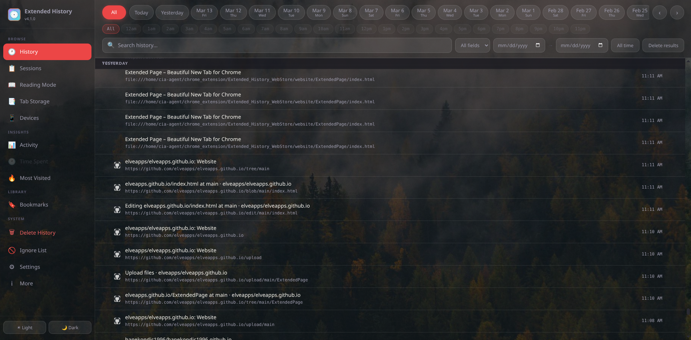

#  Extended History (Firefox addon)  
**For more info check the main branch:**
<pre>
<a href='https://github.com/banekondic1996/Extended-History---Chrome/tree/main'>Link</a>
</pre>
**Features:**
<pre>
-Filter history by date, url, title
-See time spent on websites and total page loads
-Export and import history and bookmarks
-Export session tabs and see previous sessions
-Quick access to recent history by pressing extension button 
-Change accent colors and wallpapers with glass like UI if you are into that
-Delete history per day, based on filter, or selection
-Option to periodically save session as html file
-Keep history more then 90 days
-Store tabs
-Encrypt history exports
-Read exported history, without import, even encrypted ones
-Find history using quick filters
-Lock history
</pre>

 

